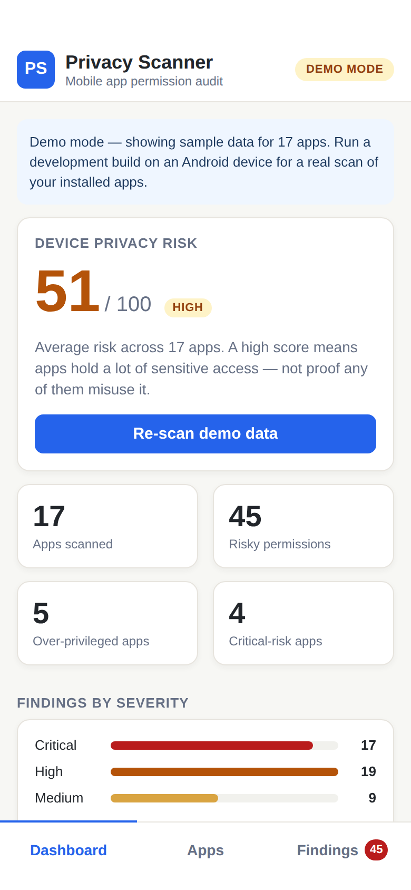
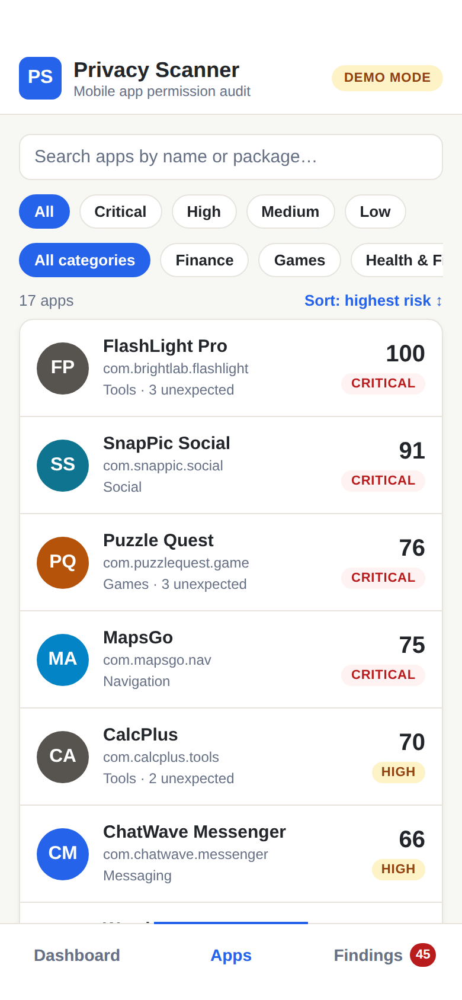
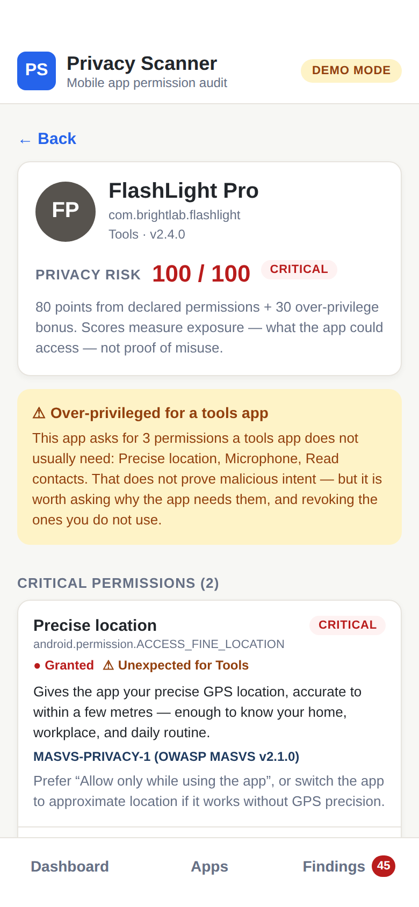
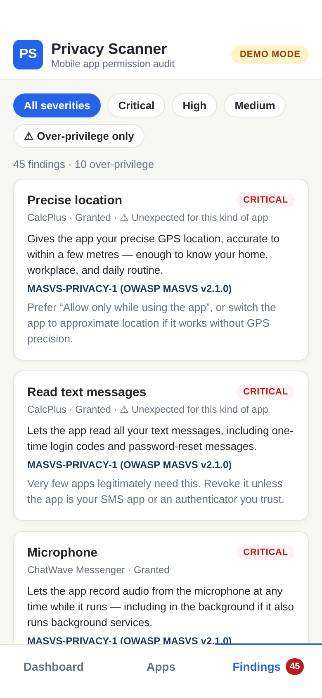

# Privacy Scanner — Mobile App Privacy Scanner


**Live demo:** https://mob-privacy-scanner-v1.vercel.app — try it in your browser, no install needed (demo mode with sample data).

A React Native (Expo) tool that audits the apps installed on a phone and flags
risky permissions — in plain language, with an explainable risk score for every
app and for the device overall.

It answers three questions:

1. **What can each app access?** Microphone, location, camera, contacts,
   SMS, call logs, sensors — every declared permission, with a plain-language
   explanation of what it exposes and what to do about it.
2. **How risky is that?** Every app gets a 0–100 privacy risk score, and the
   device gets an overall score.
3. **Is the app asking for more than it should?** Over-privilege detection
   flags permissions that don't fit the app's category — a flashlight app
   asking for location and microphone is suspicious; a messaging app asking
   for the microphone is expected.

| Dashboard | App list |
| --- | --- |
|  |  |
| App detail | Findings |
|  |  |

_Screenshots show demo mode with fictional sample data (see
[Demo mode](#demo-mode))._

## Features

- **Per-app risk scores (0–100)** — explainable formula, with a points
  breakdown shown on every app's detail screen.
- **Device score** — the mean of all app scores, plus counts by risk band.
- **41-permission database** — curated Android permissions with risk levels,
  categories, plain-language "what it exposes" text, revoke guidance, and
  OWASP MASVS references.
- **Over-privilege detection** — permission-vs-category expectation table
  covering 12 app categories; system apps are never flagged, and unknown
  permissions are never flagged.
- **Findings view** — every flagged permission across all apps, filterable by
  severity and by over-privilege only.
- **Search, filter, sort** — find any app by name or package, filter by risk
  band or category, sort by risk or name.
- **Demo mode** — works with zero setup on web, in Expo Go, and on iOS, with
  17 fictional apps across 12 categories, including clear over-privilege cases.
- **Real Android scanning** — a local Expo native module (Kotlin) reads
  installed apps and their permissions via `PackageManager`, including grant
  state.
- **Private by design** — all scanning and scoring happens on the device.
  Nothing is uploaded anywhere.

## How the risk score works

The score measures **exposure** — what an app *could* access — not proof of
misuse. A navigation app legitimately needs location and will score high on
exposure; that is expected, and the app is only flagged as over-privileged
when a permission doesn't fit its category.

| Permission risk | Points |
| --- | --- |
| Critical (microphone, precise location, SMS, call logs) | 25 |
| High (camera, contacts, coarse location, body sensors) | 15 |
| Medium (calendar, media files, Bluetooth, activity) | 8 |
| Low (notifications, vibration, biometrics) | 3 |
| Info (internet, foreground service) | 0 |

- A permission that is **declared but not granted** counts half points
  (rounded) — it is still a risk, because the app can ask for it later.
- **Over-privilege bonus:** +10 for each unexpected *granted* critical/high
  permission, +5 for each unexpected granted medium permission or unexpected
  *requested* medium+ permission, capped at +30.
- **Score** = min(100, permission points + over-privilege bonus).
- **Device score** = mean of all app scores, rounded.

| Band | Score |
| --- | --- |
| Low | 0–24 |
| Medium | 25–49 |
| High | 50–74 |
| Critical | 75–100 |

### Demo data, worked example

In demo mode the device scores **51 / 100 (High)** across 17 apps, with
**45 findings** (17 critical, 19 high, 9 medium), **5 over-privileged apps**
and **10 over-privilege findings**. The worst app is the fictional
**FlashLight Pro — 100 / 100 (Critical)**: 80 points from its declared
permissions plus the maximum +30 over-privilege bonus, for asking for precise
location, microphone and contacts — none of which a torch needs.

## Permission model & OWASP MASVS mapping

Every permission in the database maps to a verified control from
[OWASP MASVS v2.1.0](https://mas.owasp.org/MASVS/):

| MASVS control | Statement | Used for |
| --- | --- | --- |
| MASVS-PRIVACY-1 | "The app minimizes access to sensitive data and resources." | Nearly all permissions — any access beyond what the app needs is a data-minimization failure. |
| MASVS-PRIVACY-2 | "The app prevents identification of the user." | Identifier permissions: `READ_PHONE_STATE`, `AD_ID`. |

Only these two controls are used, because they are the two whose IDs and
statements were verified against the MASVS v2.1.0 documentation. No control
numbers were invented. Permissions not in the database get a safe fallback
(low risk, no MASVS reference, never flagged) rather than a guessed rating.

Risk levels are assigned by what the permission exposes: anything that can
record you, track you, or read your private messages is critical; anything
that identifies you or reads a sensitive data store is high; and so on. The
full table lives in `app/src/permissions/permission-db.js`.

## Architecture

```
mobile-privacy-scanner/
├── app/                                # Expo app (JavaScript, SDK 58)
│   ├── App.js                          # shell: tabs, scan orchestration
│   ├── app.json                        # "Privacy Scanner"
│   ├── src/
│   │   ├── permissions/
│   │   │   └── permission-db.js        # 41 Android permissions
│   │   ├── risk/
│   │   │   ├── engine.js               # scoring, findings, device summary
│   │   │   └── expectations.js         # permission-vs-category table
│   │   ├── scanner/
│   │   │   ├── index.js                # scanDevice(): live / demo / iOS
│   │   │   ├── demo-inventory.js       # 17 fictional demo apps
│   │   │   └── native-bridge.js        # loads the native module if linked
│   │   └── ui/
│   │       ├── theme.js                # light palette
│   │       ├── components.js           # badges, pills, cards
│   │       ├── Dashboard.js            # device score, stats, top risks
│   │       ├── AppList.js              # search / filter / sort
│   │       ├── AppDetail.js            # grouped permissions + guidance
│   │       └── Findings.js             # all flagged permissions
│   └── modules/privacy-scanner/        # local Expo module (Kotlin + JS)
│       ├── src/index.js                # getInstalledApps() bridge
│       └── android/.../PrivacyScannerModule.kt
├── tests/                              # node:test suites (60 tests)
└── docs/screenshots/
```

The pure logic (permission DB, risk engine, expectations, scanner
abstraction, demo inventory) is plain CommonJS with no React Native imports,
so it is fully testable with `node:test` — 60 tests cover scoring math, band
boundaries, over-privilege heuristics, the permission database, and the
scanner's live/demo/iOS behaviour.

The native module is a standard Expo local module: Kotlin code under
`android/` enumerates installed packages with `PackageManager` and reads each
permission's grant state from `PackageInfo.requestedPermissionsFlags`. The JS
bridge loads it with `requireNativeModule` and returns `null` when it is not
linked (web, Expo Go, iOS), so the app always falls back to demo mode instead
of crashing.

## How to run

### Demo mode (zero setup)

```bash
cd app
npm install
npx expo start
```

Open it in **Expo Go** (scan the QR code) or press `w` for the web version.
With no native module available, the app runs against the demo inventory
automatically — no setup, no device needed.

To build the web export:

```bash
cd app
npx expo export --platform web
# serve dist/ with any static server, e.g. python3 -m http.server -d dist 8000
```

### Real Android scan (development build)

Real scanning needs a development build on an Android device — Expo Go cannot
load the local native module.

```bash
cd app
npx expo prebuild
npx expo run:android
```

Requirements: Android SDK, an Android device or emulator (API 26+).
The module declares `QUERY_ALL_PACKAGES` in its manifest, which Android 11+
requires to enumerate all installed apps.

### Tests

```bash
npm test        # from the project root — 60 tests, node:test
```

## Demo mode

The demo inventory is 17 **fictional** apps with invented names and package
names (FlashLight Pro, CalcPlus, Puzzle Quest, …). They are deliberately
varied: a clean note app scoring 11, a navigation app scoring 75 on exposure
alone (expected for its category), and clear over-privilege cases — a
flashlight asking for location, microphone and contacts; a calculator asking
for location and SMS. No real app is accused of anything.

## Limitations (honest)

- **iOS cannot be scanned.** The iOS sandbox forbids listing installed apps
  or reading their permissions. On iOS the app explains this and offers the
  demo data to explore. This is a platform limit, not a missing feature.
- **Native module: written, not yet verified on-device.** The Kotlin module
  was written against the Expo Modules API (SDK 58) and the Android
  `PackageManager` API, but the environment it was built in has no Android
  SDK, so it has not been compiled or run on a device yet. Verify with a
  development build (`npx expo prebuild && npx expo run:android`) before
  relying on live-scan results.
- **Play Store policy:** `QUERY_ALL_PACKAGES` is a restricted permission.
  A Play Store release needs a declaration explaining the core use case — a
  privacy scanner whose entire purpose is auditing installed apps.
  Sideloaded and development builds are unaffected.
- **Scores are heuristic.** They measure exposure from declared permissions,
  not observed behaviour. They cannot tell whether an app actually misuses a
  permission, and they do not cover network exfiltration, trackers, or
  runtime behaviour — that is a different tool.
- **Grant state is a snapshot.** Permissions can be granted or revoked at any
  time; re-scan to refresh.
- **expo-doctor** reports 19/20 with one known cosmetic warning: the local
  module's `expo-modules-core` peer dependency, which is satisfied
  transitively through the `expo` package. Do not "fix" it by adding
  `expo-modules-core` as a direct dependency — doctor then fails the opposite
  check. See `app/modules/privacy-scanner/README.md`.

## Privacy

All scanning and scoring happens on the device. The app makes no network
requests and sends nothing anywhere. In demo mode there is no real data at
all.

## License

MIT — see [LICENSE](LICENSE). The Expo template scaffolding in `app/` keeps
its own license (`app/LICENSE`, Expo / 650 Industries).
